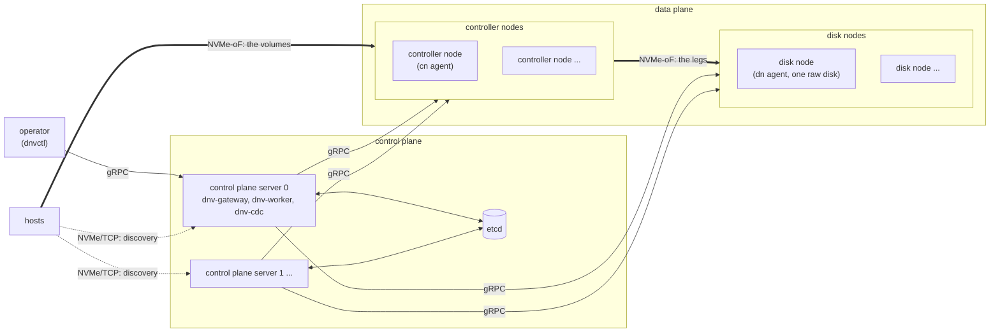
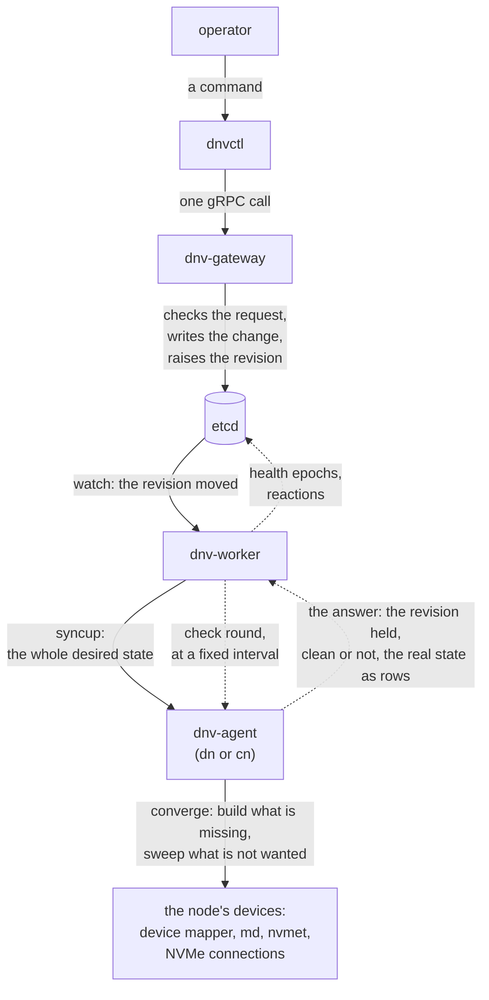
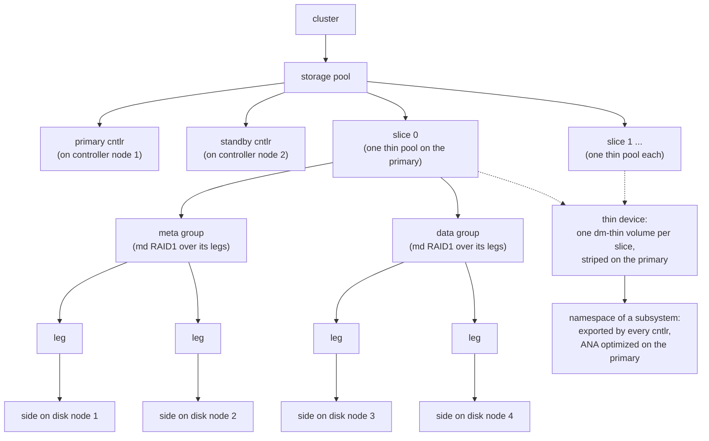
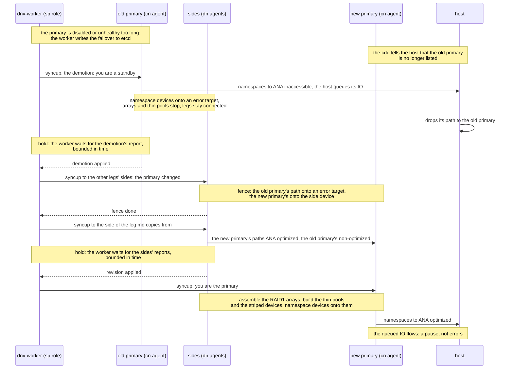
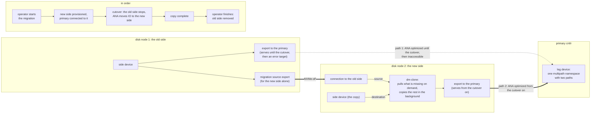
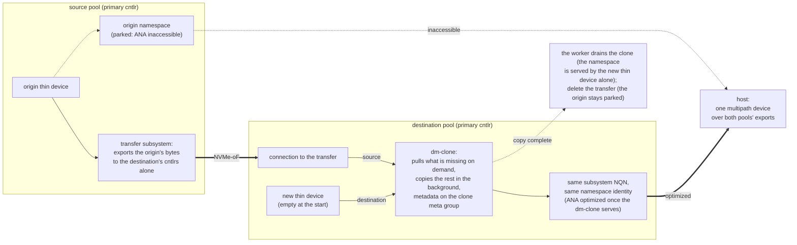

# dnv: an introduction

## What dnv is for

dnv is a distributed NVMe-oF block storage system. It aggregates the raw disks
of disk nodes into storage pools, runs the volume logic (thin provisioning,
striping, redundancy, snapshots, cloning, live migration) on controller nodes,
and exports virtual volumes to hosts over NVMe-oF with native NVMe multipath
and ANA, the NVMe way of saying which path serves IO. etcd holds all desired
state; the control-plane processes and the per-node agents converge the data
plane to it.

A host sees a volume as one namespace of an NVMe-oF subsystem. It may connect
to several controller nodes for the same volume; the kernel joins these paths
into one multipath device, and ANA picks the path. The data plane is built from stock Linux pieces: device
mapper, md RAID1 and the kernel's NVMe target and host drivers.

dnv can be the data plane of a multi-tenant block storage system, for example
behind Kubernetes or OpenStack Cinder. A tenant is a user of that system. dnv
knows no tenants and authenticates nobody: the layer above authenticates its
users and decides which storage pools, subsystems and hosts serve each of
them. dnv promises that layer that the data of one storage pool is never
readable from another storage pool, unless that layer exports it there itself,
for example with a transfer, or a step of a caller breaks the promise, as
[dnv's scope and known limits](scope.md) says. The promise is about what a
host can read, not about the network or the nodes: the network under dnv and
the root user of every node are trusted.

The words are those of [the core glossary](core_glossary.md), the list to read
first; any other project word is explained where it first appears.

## The six programs

Three programs make the control plane, with etcd beside them. `dnv-gateway`
is the API server: it checks every request of an operator, writes any change
to etcd, and builds nothing on the nodes. `dnv-worker` makes the nodes follow
etcd, in its dn, cn and sp roles; it judges health and runs the reactions,
failover, auto-grow, cntlr replacement and leg repair, and several workers
share the work. `dnv-cdc` is the NVMe-oF discovery service: it tells a host
where its subsystems are, and when that answer changes. etcd holds the
desired state of every node and storage pool, and only those three talk to
it.

`dnv-agent` runs on every node, as the dn agent on a disk node and the cn
agent on a controller node: it builds and removes the local devices (device
mapper, md, nvmet, NVMe connections) so that the node matches its desired
state, reports the real state, keeps the last desired state it accepted in
local files, and never talks to etcd. `dnvctl` is the command line tool of
the operator, one command for each call of the gateway API.

`dnv-csi` connects dnv to Kubernetes through the Container Storage Interface
(CSI), the plugin API Kubernetes uses to create, attach and mount volumes.
Every Kubernetes volume is a storage pool of its own with one thin device, one
subsystem and one namespace. Its controller plugin talks to the gateway; its
node plugin, one per Kubernetes node, asks the cdc where the subsystem is,
connects, formats and mounts, and it follows the discovery log itself,
connecting and dropping paths as the cdc's answer changes, so that node needs
no nvme-stas, the Linux program that does this for a host.

## The physical view

Hosts talk NVMe-oF to the controller nodes, and the controller nodes talk
NVMe-oF to the disk nodes, where all volume data lives. The control plane
servers read and write etcd and reach every node through its agent over gRPC,
the remote-call protocol of the programs, which carries no IO; the operator's
`dnvctl` talks gRPC to the gateway, and hosts ask the cdc on those servers
where their subsystems are.



*The physical view: hosts, the data plane and the control plane; IO over
NVMe-oF, control over gRPC.*

## How a change travels

The gateway checks the request, writes the change to etcd and raises the
revision of the node or pool it touches. The worker sees the revision move and
sends the agent a syncup, which carries the whole desired state. The agent
converges: it reads what the node has now, builds what is missing and sweeps
what is not wanted. The check round runs the other way, at a fixed interval:
the worker asks, and the agent answers with the revision it holds, whether the
node is clean, and the real state when it changed, as rows. From the rows the
worker judges health, and a reaction is one more change in etcd, which travels
the same way down.



*How a change travels down to the devices, and the check round's answer back
up.*

## A storage pool

On the controller nodes a pool has cntlrs: exactly one is the primary, which
serves IO; the others are standby, connected to the legs and ready to take
over. On the disk nodes it has space, organized as slices, groups, legs and
sides. A slice is one thin pool on the primary; a meta group holds that thin
pool's metadata and a data group its data; a group with redundancy is an md
RAID1 array over its legs; a leg is one copy, stored as a side on one disk
node. A thin device is one dm-thin volume in every slice, joined on the
primary by one striped device, and a host sees it as a namespace of a
subsystem, which every cntlr exports under the same NQN, the name of an
NVMe-oF subsystem, ANA optimized on the primary and inaccessible on the
standbys.



*A storage pool: cntlrs, slices, groups, legs, sides, and a thin device over
the slices.*

## Failover

The worker starts a failover when the primary is disabled or has been
unhealthy for longer than the pool's threshold. The old primary is out of the
cdc's answer by then, taken out by the failover's own change or by the disable
that triggered it, so the cdc tells the hosts, and a host that follows the
discovery log drops that path and queues its IO. The worker does not wait for
that: it drives the pool's syncups in a fixed order with a hold between the
steps. First the old primary's demotion: it moves its namespaces to ANA
inaccessible before anything else, so that the host is told to stop using the
path before the path stops working, then puts its namespace devices on an
error target, a device-mapper table that fails every IO, and stops its arrays
and thin pools; its legs stay connected. Then the fence: each disk node
reloads the old primary's path onto an error target and the new primary's
onto the side device, and moves ANA with them. In each RAID1 group the worker
fences the leg md copies from last: it tells that leg's disk node only once
the other legs' disk nodes report their fence done, or after one interval.
So a write that an old primary still serving completed is on that leg, the
one the new primary's start of the array copies from, but for the few
cases [the scope page](scope.md#51-hosts-flushes-and-snapshots) lists. Then the new primary assembles
the arrays, builds the thin pools and the striped devices, and only then moves
its namespaces to ANA optimized. In the common case, a dead controller node,
the host sees a pause, not errors: its IO queues until the new primary moves
its namespaces to ANA optimized.



*A failover: demotion, fence, the new primary's build, what the host sees.*

## Migration

For the time of the migration the leg has two sides; once the new side is
provisioned both export the same subsystem, so the primary's kernel sees one
namespace with two paths and nothing above the leg changes. The operator starts the migration; the new side
is provisioned on the other disk node, and the primary connects to it. The
worker starts the cutover only once the primary has a live path to the new
side: the old side stops serving, and ANA moves the IO to the new side's
dm-clone, the device-mapper target that copies a source device into a
destination device while serving IO. The dm-clone pulls what is missing from
the old side on demand and copies the rest in the background; its metadata
lives on the disk node's disk, so a reboot resumes the copy. Once the old side
takes no more writes, the worker reads the leg's bitmap, the list of the blocks
the pool has written on the leg, and hands it to the new side, so that the copy
skips the rest. When the copy is complete the operator finishes the migration,
and the old side is removed.



*A migration: one leg with two sides, the copy, the cutover and the finish.*

## Transfer and clone

The host on the right has one multipath device over the exports of two pools,
because the destination pool exports the same subsystem NQN and the same
namespace identity as the source. The origin is the volume being moved. A
transfer in the source pool exports the origin's bytes over a subsystem made
for this purpose, to the destination's cntlrs alone; created with the option
a live migration uses, it also parks the origin namespace, that is, moves it
to ANA inaccessible on every cntlr. A clone in the destination pool pulls those bytes
with dm-clone into a new, empty thin device, keeps the copy's metadata on the
clone meta group, a group of the pool made for this, and moves its namespace
to ANA optimized once the dm-clone serves; until that move the host's IO
queues. When the copy is complete, the clone leaves by itself: the worker
sees the whole copy in the primary's report, marks the clone as deleting
and drains it, and the new thin device then serves the namespace alone. The
operator deletes the transfer, which keeps the origin parked. An abort is lossless only while nothing has written through
the destination. The two pools can be in different clusters.



*A transfer and a clone: the source exports, the destination pulls, the host
moves over.*

## Requirements

dnv is tested on Ubuntu 26.04 LTS with the kernel 7.0.0-38-generic, the lab
VMs' distribution and kernel.

Tools: nvme-cli, mdadm, nvme-stas, a 2.x version with its daemons stafd and
stacd, dmsetup, and thin-provisioning-tools, whose thin_dump the agents run,
all of which the all-in-one tutorial installs, and losetup from util-linux for
its loop-device disks. The agents also run blkdiscard and lsblk from
util-linux. nvme-stas is 2.x because dnv is tested with 2.x alone; 3.x is
untested with dnv.

Kernel: the NVMe/TCP target and host drivers nvmet, nvmet-tcp, nvme-tcp and
nvme-fabrics; native NVMe multipath switched on, which joins a host's paths
into one device and carries the ANA state; md RAID1; device mapper with the
thin-pool, thin, clone, linear, striped, error and flakey targets; and configfs
mounted. Every controller node of a cluster runs one kernel series: a RAID1
array created on a 6.19 or newer kernel is refused by an older one, so a
failover to a controller node on the older kernel cannot start the pool. On a
controller node `nvme_core.io_timeout` keeps the kernel's default, 30 s, and is
never raised to its largest value, 4294967295, which some cloud images set so
that an IO never times out: it is the only bound on a write to a disk that
stalls while its disk node still answers the keep-alives of the connection,
the messages by which the kernel finds a silent target.

Two settings the tutorial shows: a udev rule that keeps the system's own md
assembly off dnv arrays, on disk nodes too, since a controller node's md
superblocks reach their devices through the side exports; and the masked
nvmf-connect unit, so that nvme-stas is the only program that connects to
what a discovery change announces.

etcd: a release of 3.5.13 or later, run with the request caps and automatic
compaction the tutorial's etcd command shows; the tutorial and the suites use
v3.6.14.

A host: an NVMe/TCP initiator with native multipath and a follower of the
discovery log such as nvme-stas, which drops a failed-over primary's path; a
path that no follower manages is never dropped.

To build: Go 1.26.5 or newer. For the CSI driver: Kubernetes 1.34 or newer,
k3s in its tutorial, and docker to build the driver's image; a Kubernetes node
that mounts an xfs volume runs a kernel of 5.19 or newer, since the driver's
image formats xfs with a filesystem feature that kernels before 5.19 cannot
mount.

## Status and limits of 0.1

0.1 is the first release of dnv. Every part is exercised by the integration
suites on lab VMs and by the two tutorials. No production deployment is known.
Linux x64 is the only platform.

The network and the root user of every node are trusted: dnv authenticates no
user and no host beyond its NQN, a name a host can spoof, gRPC is plain text,
nothing is encrypted, and root on a node can read the old bytes of a recycled
extent from the raw disk. Deploy dnv on an isolated network you trust.

[dnv's scope and known limits](scope.md) says what dnv promises, the data
loss it accepts and what it does not do. It also gives every other known
limit of dnv, with its state and what you can do about it; the sizes
below and the limits of the test suites are not in it. Read it before you
deploy dnv.

0.1 publishes no throughput or latency figures. The failover pause was
measured on the lab VMs as the longest write queued through a failover of a
primary whose agent is stopped while its kernel goes on serving. The figure
therefore leaves out the time the worker takes to judge the primary
unhealthy, which a dead controller node adds. For a 4 KiB write with a
flush to the raw device of a host under nvme-stas, the pause was about 2 s
at one slice (commit 1b1cba4), and, on builds of ed69649 with uncommitted
changes, about 2 s at one slice, 3 s at four slices and, in the one run at
32 slices, 22 s. For a 1 MiB write with a flush to a file on a volume
mounted under the CSI driver, whose pools have one slice, it was about
3.6 s (commit 1b1cba4).

The limits dnv enforces, each against the largest size a test has run. The
Go tests run the control plane against fake agents, test programs that answer
an agent's calls with no node behind them, and the agents against a fake
machine, test code in place of a node's kernel and tools; they reach every
limit, each at its value with the next one refused, or for a controller
node's budget cut to it. The suites run on the lab VMs, most of them with
real agents on real nodes and the worker's and the gateway's suites with fake
agents, and stay far below most limits. A size only the Go tests reach is
proven against fakes alone.

| Limit | Value | Largest run in the Go tests | Largest run on the lab VMs |
|---|---|---|---|
| Disk nodes per cluster | 1024 | 1024 | 180 dn agents on four guests, at 32 slices |
| Controller nodes per cluster | 1024 | 1024 | 3 |
| Storage pools per cluster | 4096 | 4096 | 8 at once as CSI volumes, on real nodes; 10 at once in a suite on fake agents |
| Slices per pool | 32 | 32, committed on a real etcd | 32; 1 under the CSI driver |
| Cntlrs per pool | 4 | 4 | 3 |
| Cntlrs per controller node | 256 | 256, and a real cn agent on a fake machine converged 257 | about 10 |
| Sides per disk node | 1024 | 1024, and a real dn agent on a fake machine converged 1025 | about 10 |
| Groups per slice, meta and data each | 255 | 255 data groups, grown without redundancy; a full meta list, and a full list with RAID1, only written to etcd directly | about 2 |
| Thin devices per pool | 1024 | 1024 | a few |
| Subsystems per pool; namespaces per subsystem; hosts per subsystem | 4; 4; 8 | each at its value | 1; 2; 4 |
| Clones; transfers; migrations per pool | 64; 4; 4 | each at its value | 1; 1; 2 |
| Retired legs per group, the replaced legs a group keeps with their data after its repairs | 2 | 2 | retired legs made, taken back into a group by a repair, and deleted |
| Bitmap chunks, the pieces of the list of blocks a copy must take: per source slice of a clone, which an operator appends; per migration, which the worker cuts from its own read, 4 MiB each | 16; 16 | 16; 16 | 2; 2 on real agents; 13, written to etcd directly, and 1 in a suite on fake agents |
| Thin ids per pool, one taken from a counter by every thin device the pool creates, snapshots included | 16,777,215 | the counter set to the limit by hand, one create at it, the next refused | no test reaches it |
| Extent size | 64 MiB to 1 TiB | pools created on 5 GiB extents; 1 TiB checked by validation alone | 64 MiB and 1 GiB; no run at 1 TiB |
| Controller node budget | one extent to 64 TiB, set once per node: a larger `--capacity` is cut to 64 TiB, one smaller than an extent is refused, and one under 1 KiB counts as unset | the bounds, through the create with a fake agent | the default on real nodes; a budget of about 12 TiB on fake agents in a suite |

To measure dnv fairly, write the whole volume first, since a thin device
returns zeros for a block it has not written without reading any disk; run
4 KiB random IO over a range of queue depths; and compare the result with the
raw disk and with a plain nvmet export of the same disk, so that the cost of
dnv's layers is told apart from the disk's and the network's.

## Get dnv

The release is the archive `dnv-v0.1.0-linux-amd64.tar.gz` and the file
`SHA256SUMS` on the GitHub release of the tag v0.1.0:
https://github.com/distributed-nvme/distributed-nvme/releases/tag/v0.1.0.
Download both into one directory, then check and unpack:

```
sha256sum -c SHA256SUMS
tar xzf dnv-v0.1.0-linux-amd64.tar.gz
```

The archive unpacks to one folder, `dnv-v0.1.0-linux-amd64`, with the six
binaries, the `LICENSE` file and the `deploy/` directory, the CSI driver's
image recipe and manifests.

Or clone the repository and build it with Go 1.26.5 or newer, which puts the
six binaries in `bin/`:

```
git clone https://github.com/distributed-nvme/distributed-nvme.git
cd distributed-nvme
make build
```

The version is stamped into every binary and `go version -m <binary>` prints
it, v0.1.0 for a release build; no program has a version flag.

etcd is not in the archive. Fetch etcd v3.6.14 for linux-amd64 from
https://github.com/etcd-io/etcd/releases/tag/v3.6.14, the file
`etcd-v3.6.14-linux-amd64.tar.gz`, and put its `etcd` binary beside the dnv
binaries, where the tutorial expects it.

Then read [dnv on one machine](tutorial_all_in_one.md), a whole dnv system on
one Linux machine with a host connected to a volume, and [dnv under Kubernetes
on one machine](tutorial_csi.md), which adds a one-node Kubernetes and gives a
pod, the Kubernetes unit of one or more containers, a dnv volume through the
CSI driver. dnv is released under the MIT license: [LICENSE](../../LICENSE).
