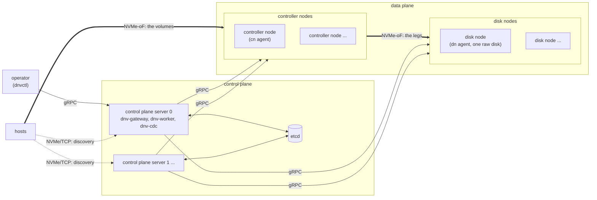
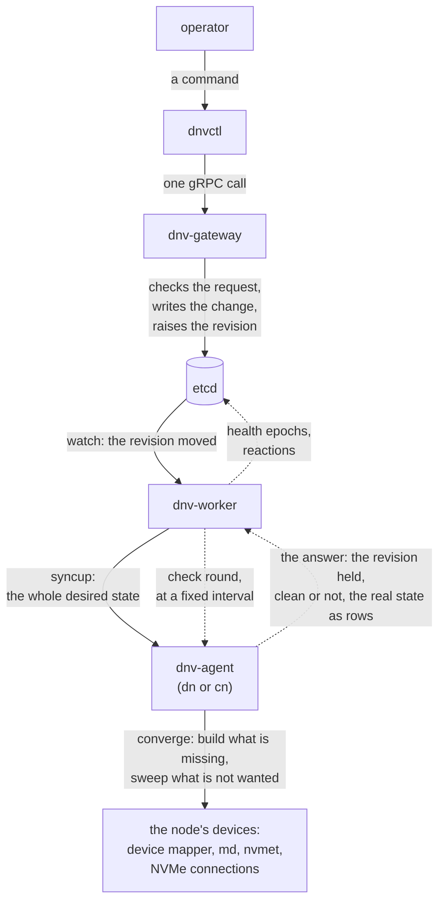
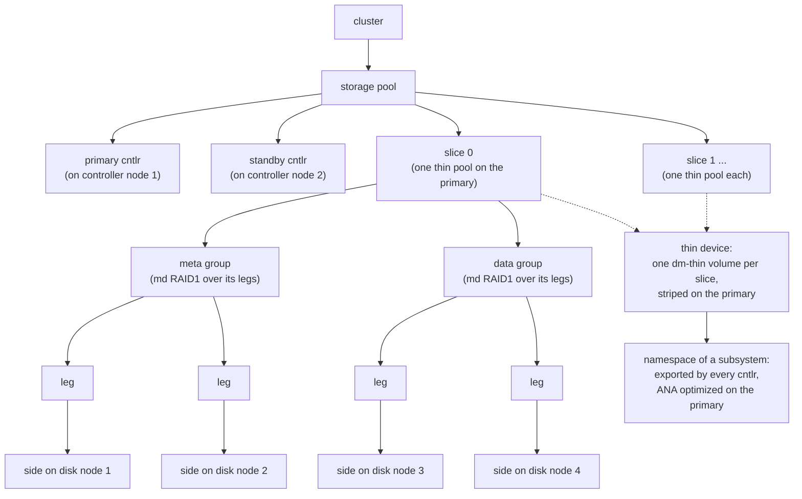
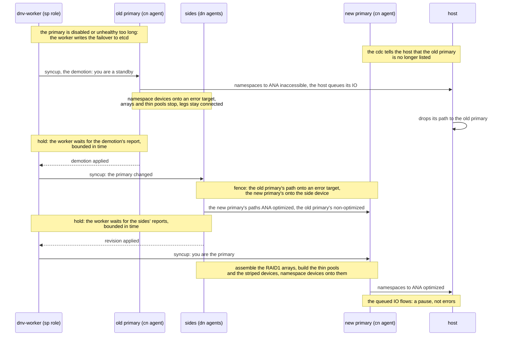
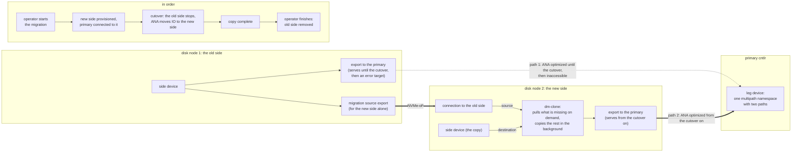
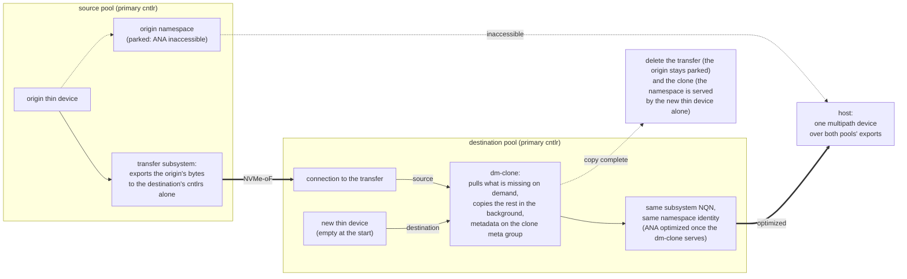

# dnv: an introduction

## What dnv is for

dnv is a distributed NVMe-oF block storage system. It aggregates the raw disks
of disk nodes into storage pools, runs the volume logic (thin provisioning,
striping, redundancy, snapshots, cloning, live migration) on controller nodes,
and exports virtual volumes to hosts over NVMe-oF with native NVMe multipath
and ANA, the NVMe way of saying which path serves IO. etcd holds all desired
state; the control-plane processes and the per-node agents converge the data
plane to it.

A host sees a volume as one namespace of an NVMe-oF subsystem. It may connect
to several controller nodes for the same volume; the kernel joins these paths
into one multipath device, and ANA picks the path. The data plane is built from stock Linux pieces: device
mapper, md RAID1 and the kernel's NVMe target and host drivers.

dnv can be the data plane of a multi-tenant block storage system, for example
behind Kubernetes or OpenStack Cinder. A tenant is a user of that system. dnv
knows no tenants and authenticates nobody: the layer above authenticates its
users and decides which storage pools, subsystems and hosts serve each of
them. dnv promises that layer that the data of one storage pool is never
readable from another storage pool, unless that layer exports it there itself,
for example with a transfer, or a step of a caller breaks the promise, as the
limits below say. The promise is about what a host can read, not about the
network or the nodes: the network under dnv and the root user of every node are
trusted.

The words are those of [the core glossary](core_glossary.md), the list to read
first; any other project word is explained where it first appears.

## The six programs

Three programs make the control plane, with etcd beside them. `dnv-gateway`
is the API server: it checks every request of an operator, writes any change
to etcd, and builds nothing on the nodes. `dnv-worker` makes the nodes follow
etcd, in its dn, cn and sp roles; it judges health and runs the reactions,
failover, auto-grow, cntlr replacement and leg repair, and several workers
share the work. `dnv-cdc` is the NVMe-oF discovery service: it tells a host
where its subsystems are, and when that answer changes. etcd holds the
desired state of every node and storage pool, and only those three talk to
it.

`dnv-agent` runs on every node, as the dn agent on a disk node and the cn
agent on a controller node: it builds and removes the local devices (device
mapper, md, nvmet, NVMe connections) so that the node matches its desired
state, reports the real state, keeps the last desired state it accepted in
local files, and never talks to etcd. `dnvctl` is the command line tool of
the operator, one command for each call of the gateway API.

`dnv-csi` connects dnv to Kubernetes through the Container Storage Interface
(CSI), the plugin API Kubernetes uses to create, attach and mount volumes.
Every Kubernetes volume is a storage pool of its own with one thin device, one
subsystem and one namespace. Its controller plugin talks to the gateway; its
node plugin, one per Kubernetes node, asks the cdc where the subsystem is,
connects, formats and mounts, and it follows the discovery log itself,
connecting and dropping paths as the cdc's answer changes, so that node needs
no nvme-stas, the Linux program that does this for a host.

## The physical view

Hosts talk NVMe-oF to the controller nodes, and the controller nodes talk
NVMe-oF to the disk nodes, where all volume data lives. The control plane
servers read and write etcd and reach every node through its agent over gRPC,
the remote-call protocol of the programs, which carries no IO; the operator's
`dnvctl` talks gRPC to the gateway, and hosts ask the cdc on those servers
where their subsystems are.



*The physical view: hosts, the data plane and the control plane; IO over
NVMe-oF, control over gRPC.*

## How a change travels

The gateway checks the request, writes the change to etcd and raises the
revision of the node or pool it touches. The worker sees the revision move and
sends the agent a syncup, which carries the whole desired state. The agent
converges: it reads what the node has now, builds what is missing and sweeps
what is not wanted. The check round runs the other way, at a fixed interval:
the worker asks, and the agent answers with the revision it holds, whether the
node is clean, and the real state when it changed, as rows. From the rows the
worker judges health, and a reaction is one more change in etcd, which travels
the same way down.



*How a change travels down to the devices, and the check round's answer back
up.*

## A storage pool

On the controller nodes a pool has cntlrs: exactly one is the primary, which
serves IO; the others are standby, connected to the legs and ready to take
over. On the disk nodes it has space, organized as slices, groups, legs and
sides. A slice is one thin pool on the primary; a meta group holds that thin
pool's metadata and a data group its data; a group with redundancy is an md
RAID1 array over its legs; a leg is one copy, stored as a side on one disk
node. A thin device is one dm-thin volume in every slice, joined on the
primary by one striped device, and a host sees it as a namespace of a
subsystem, which every cntlr exports under the same NQN, the name of an
NVMe-oF subsystem, ANA optimized on the primary and inaccessible on the
standbys.



*A storage pool: cntlrs, slices, groups, legs, sides, and a thin device over
the slices.*

## Failover

The worker starts a failover when the primary is disabled or has been
unhealthy for longer than the pool's threshold. The old primary is out of the
cdc's answer by then, taken out by the failover's own change or by the disable
that triggered it, so the cdc tells the hosts, and a host that follows the
discovery log drops that path and queues its IO. The worker does not wait for
that: it drives the pool's syncups in a fixed order with a hold between the
steps. First the old primary's demotion: it moves its namespaces to ANA
inaccessible before anything else, so that the host is told to stop using the
path before the path stops working, then puts its namespace devices on an
error target, a device-mapper table that fails every IO, and stops its arrays
and thin pools; its legs stay connected. Then the fence: each disk node
reloads the old primary's path onto an error target and the new primary's
onto the side device, and moves ANA with them. Then the new primary assembles
the arrays, builds the thin pools and the striped devices, and only then moves
its namespaces to ANA optimized. In the common case, a dead controller node,
the host sees a pause, not errors: its IO queues until the new primary moves
its namespaces to ANA optimized.



*A failover: demotion, fence, the new primary's build, what the host sees.*

## Migration

For the time of the migration the leg has two sides; once the new side is
provisioned both export the same subsystem, so the primary's kernel sees one
namespace with two paths and nothing above the leg changes. The operator starts the migration; the new side
is provisioned on the other disk node, and the primary connects to it. The
worker starts the cutover only once the primary has a live path to the new
side: the old side stops serving, and ANA moves the IO to the new side's
dm-clone, the device-mapper target that copies a source device into a
destination device while serving IO. The dm-clone pulls what is missing from
the old side on demand and copies the rest in the background; its metadata
lives on the disk node's disk, so a reboot resumes the copy. A caller may hand
the migration the leg's bitmap, the list of the blocks the pool has written on
the leg, so that the copy skips the rest; the limits below say when to read
it. When the copy is complete the operator finishes the migration, and the old
side is removed.



*A migration: one leg with two sides, the copy, the cutover and the finish.*

## Transfer and clone

The host on the right has one multipath device over the exports of two pools,
because the destination pool exports the same subsystem NQN and the same
namespace identity as the source. The origin is the volume being moved. A
transfer in the source pool exports the origin's bytes over a subsystem made
for this purpose, to the destination's cntlrs alone; created with the option
a live migration uses, it also parks the origin namespace, that is, moves it
to ANA inaccessible on every cntlr. A clone in the destination pool pulls those bytes
with dm-clone into a new, empty thin device, keeps the copy's metadata on the
clone meta group, a group of the pool made for this, and moves its namespace
to ANA optimized once the dm-clone serves; until that move the host's IO
queues. When the copy is complete, the operator deletes the transfer, which
keeps the origin parked, and the clone; the new thin device then serves the
namespace alone. An abort is lossless only while nothing has written through
the destination. The two pools can be in different clusters.



*A transfer and a clone: the source exports, the destination pulls, the host
moves over.*

## Requirements

dnv is tested on Ubuntu 26.04 LTS with the kernel 7.0.0-38-generic, the lab
VMs' distribution and kernel.

Tools: nvme-cli, mdadm, nvme-stas, a 2.x version with its daemons stafd and
stacd, dmsetup, and thin-provisioning-tools, whose thin_dump the agents run,
all of which the all-in-one tutorial installs, and losetup from util-linux for
its loop-device disks. The agents also run blkdiscard and lsblk from
util-linux. nvme-stas is 2.x because dnv is tested with 2.x alone; 3.x is
untested with dnv.

Kernel: the NVMe/TCP target and host drivers nvmet, nvmet-tcp, nvme-tcp and
nvme-fabrics; native NVMe multipath switched on, which joins a host's paths
into one device and carries the ANA state; md RAID1; device mapper with the
thin-pool, thin, clone, linear, striped, error and flakey targets; and configfs
mounted. Every controller node of a cluster runs one kernel series: a RAID1
array created on a 6.19 or newer kernel is refused by an older one, so a
failover to a controller node on the older kernel cannot start the pool. On a
controller node `nvme_core.io_timeout` keeps the kernel's default, 30 s, and is
never raised to its largest value, 4294967295, which some cloud images set so
that an IO never times out: it is the only bound on a write to a disk that
stalls while its disk node still answers the keep-alives of the connection,
the messages by which the kernel finds a silent target.

Two settings the tutorial shows: a udev rule that keeps the system's own md
assembly off dnv arrays, on disk nodes too, since a controller node's md
superblocks reach their devices through the side exports; and the masked
nvmf-connect unit, so that nvme-stas is the only program that connects to
what a discovery change announces.

etcd: a release of 3.5.13 or later, run with the request caps and automatic
compaction the tutorial's etcd command shows; the tutorial and the suites use
v3.6.14.

A host: an NVMe/TCP initiator with native multipath and a follower of the
discovery log such as nvme-stas, which drops a failed-over primary's path; a
path that no follower manages is never dropped.

To build: Go 1.26.5 or newer. For the CSI driver: Kubernetes 1.34 or newer,
k3s in its tutorial, and docker to build the driver's image; a Kubernetes node
that mounts an xfs volume runs a kernel of 5.19 or newer, since the driver's
image formats xfs with a filesystem feature that kernels before 5.19 cannot
mount.

## Status and limits of 0.1

0.1 is the first release of dnv. Every part is exercised by the integration
suites on lab VMs and by the two tutorials. No production deployment is known.
Linux x64 is the only platform.

The network and the root user of every node are trusted: dnv authenticates no
user and no host beyond its NQN, a name a host can spoof, gRPC is plain text,
nothing is encrypted, and root on a node can read the old bytes of a recycled
extent from the raw disk. Deploy dnv on an isolated network you trust.

The limits a user must know:

- One primary per pool bounds a volume's throughput to one controller node:
  every thin device of a pool is served by its one primary, and slices split
  the work inside that node, never across nodes; to scale out, spread the
  pools across controller nodes.
- No QoS is enforced: nothing in dnv limits the IO rate of a volume or a pool.
- A snapshot is not atomic across a crash of the primary: it is taken slice by
  slice, and a crash between two slices, or a slice whose step was skipped or
  failed, leaves a torn snapshot. The torn mark is held in memory until the
  snapshot is recorded as created, so a restart, a failover or a cntlr
  replacement in between can lose it; delete and re-create a torn snapshot.
- A pool can run out of space: auto-grow is best effort, since a grow can find
  no disk node with room or a controller node of the pool with no room left for
  the new group, a slice holds only so many data groups, and nothing reserves
  space ahead. In a full pool an IO that needs a new block queues for a kernel
  timeout and then fails; blocks already written keep serving.
- Corrupt thin pool metadata has no repair path in dnv: repairing it is an
  operator's job, by hand, onto fresh space.
- A leg bitmap read too early during a migration can hand a pool another pool's
  bytes. The optional fast path skips the blocks of a leg that the thin pool
  has not written; read while the old side still takes writes, it misses the
  blocks written after the read, and the pool later reads there what the new
  side's recycled extents hold. Read it only after the cutover, once the
  primary's path to the new side is ANA optimized.
- A migration's bitmap appended in more than one piece can hand a pool
  another pool's bytes: the pieces join byte by byte and carry no block
  count, so a piece before the last that covers a block count that is not a
  multiple of 8 shifts every later block of the list, the copy skips blocks
  the pool wrote, and after the cutover the pool reads there what the new
  side's recycled extents hold, with no error; in a clone the same shift
  makes the clone read zeros where the source wrote. Read every piece but
  the last over a multiple of 8 blocks; one `--bm-hex` of `dnvctl` covers
  only part of a large leg, so such a leg's list is appended in pieces.
- A bitmap piece sent again without its place is stored twice: a caller that
  lost the answer to a piece and sends it again moves every later block of
  the list, with the same harm as above. `dnvctl` sends the place only when
  you give `--offset` (clone) or `--bm-idx` (migration); give it whenever
  you may send a piece again, and a piece already stored is then left as
  it is.
- A migration finished with force before its copy is complete can hand a pool
  another pool's bytes: force skips the check that the copy is complete, the
  old side is removed, and every region the copy had not reached reads what the
  new side's recycled extents hold.
- The forced start, an operator's start of a RAID1 group's array from one leg
  they name when md will not start it on its own, has sharp edges: it can
  lose the data that only the other legs held; it restores one group, not the
  pool, so a start from an older copy gives the pool a mix of older and newer
  blocks with no error, and in a data group a block the pool first used after
  that copy left the array reads what the copy holds there, which can be
  another pool's bytes; a leg that left the array before the forced start and
  is later put back into the group can be copied over with no error, losing the
  data only it held; and while one of the group's legs is being replaced it can
  leave the group down.
- A group that loses every leg at once under IO, as on a switch reload or a
  reboot of all its disk nodes, is broken by md: the kernel fails the IO on
  each lost path, md's own writes when it tears the path down and the rest
  at the 5 s fast IO fail timeout, so when the last leg fails its IO too md
  marks the array broken and refuses every write; an idle array whose legs
  all died keeps running until IO reaches it, a read as well as a write. The
  primary leaves a broken array as it is
  when the legs return, so the group stays down until an operator forces a
  start or the primary role moves to another cntlr, whose build assembles
  the array again once the legs are back; the broken array marks the primary
  unhealthy, so the worker fails it over at the primary's threshold, or, in
  a pool of one cntlr, replaces it at the cntlr threshold. A group of one leg
  returns the errors to the host, and an error that fails a commit of the
  slice's thin pool leaves that pool read-only, which nothing in dnv clears
  and no report of an agent shows; repairing it is an operator's job, as for
  corrupt thin pool metadata. The broken array refuses the thin pool's
  commits too, so when it is a data group and its slice's meta group still
  takes writes, a commit under writes turns that thin pool read-only, as for
  a group of one leg, and a new primary's build brings the array back but
  not a writable thin pool; when it is the meta group, the mark that keeps a
  pool read-only cannot be written either, so a new primary's build brings
  the pool back writable as of its last commit, without the blocks mapped
  since; a consequence worked out from md's and dm-thin's code, not
  measured.
- Writes to a group with a leg on a dead disk node wait for the kernel's
  keep-alive to give the leg's connection up, over NVMe/TCP, figures read
  from the kernel's code and timers, not measured: when the kernel tears the
  dead path down, about 6 to 10 s after the node died, md's own writes,
  which it sends with the failfast flag, fail, so md fails the member then
  and the writes complete on the other leg, and a flush md sent to that leg
  ends then as well, with no error; what md sends in the second or so
  between the keep-alive giving up and the teardown, a write or a flush,
  waits the 5 s fast IO fail timeout more, 11 to 15 s after the node died,
  and an fsync whose flush is among it waits that long; a group of one leg
  has no other leg to complete on: its writes and reads wait until the fast
  IO fail timeout and return the error, with the read-only thin pool of the
  bullet above when it fails a commit.
- Restarting a controller node's agent for longer than about 4 to 6 s at the
  defaults fails over every primary on that node, a figure worked out from
  the defaults, not measured: the agent answers no check round until the
  converge it runs at its start has ended, a round runs every 2 s, the
  primary threshold is 4 s, and two missed rounds in a row fail the primary
  over. Before maintenance, stop the workers first, as an upgrade does, or
  create pools with a larger `--thr-primary` of `dnvctl sp create`.
- A write is durable once a later flush from the host, or a write the host
  marks to reach stable storage before it completes (FUA), has completed on
  the primary that took the write, so a completed fsync survives a crash of
  the primary when that primary completed the flush itself; a primary that
  dies first loses the writes it had not committed though the host's fsync
  can still complete, since the host's kernel completes a flush it had to
  cancel on the dead path with no error, the request carrying no data to
  retry, and sends a later flush to the new primary, which commits nothing
  of the dead one's; without a flush, a write that needs a new block of the
  thin pool, to a block not written before or to one a snapshot shares, is
  committed about once a second, and a primary that dies before that commit
  loses it, the block reading as it did before the write, zeros where
  nothing was written. The volumes report a volatile write cache, so hosts
  flush as they do to a disk with one.
- A RAID1 pool survives the loss of any one disk node, but not every loss of
  two: a group's two legs sit on two disk nodes, and losing both legs of one
  group loses that slice's thin pool and with it every thin device of the
  pool, since every thin device is striped across all slices. The pairs of disk
  nodes that can cause it are at most the pool's group count, so for two
  random failures among N disk nodes the chance is at most that count
  divided by N(N-1)/2.
- Nothing limits recovery load across pools: a dead disk node starts a leg
  repair, a full copy, in every RAID1 group whose leg it held, and a dead
  controller node fails over every primary it held, all at about the same
  time; the agents set no copy speed on md, so md's own limits alone control
  the copies' speed: the kernel's `dev.raid.speed_limit_min` and
  `dev.raid.speed_limit_max`, which an array's own `md/sync_speed_min` and
  `md/sync_speed_max` override until the array stops, as read in the kernel's
  md source.
- A RAID1 pool needs four disk nodes per slice at create: the create puts
  every leg of the pool on a disk node of its own, and each slice has a meta
  group and a data group of two legs each, so a cluster with fewer disk nodes
  is refused with RESOURCE_EXHAUSTED; a group added to a slice later may
  share disk nodes with the pool's other groups.
- Every controller node has a budget, the space of the pools whose cntlrs it
  may hold, and the budgets cap a cluster's group space whatever its disks
  hold: every cntlr of a pool, primary or standby, charges its controller
  node the full size of the groups of the pool's slices, so the sum of the
  budgets divided by the cntlr count of the pools is the most group space
  the cluster holds. The budget
  is read once, at the node's create, from the `--capacity` its cn agent was
  started with, unset it takes a default, and no call changes it, so set
  `--capacity` on every cn agent before its node's create; an auto-grow
  refused for want of budget shows only in the worker's log.
- Under the CSI driver every volume is a pool with its own cntlrs and sides,
  and the counts bound the volumes: a controller node holds at most 256
  cntlrs, so a cluster holds at most 128 volumes per controller node it has
  with the default two cntlrs per volume; a cluster holds at most 4096
  pools; a disk node holds at most 1024 sides, and a RAID1 volume takes four
  at create, two more for every group auto-grow adds, and one more for every
  leg a repair adds, since the leg it replaces keeps its side for a time. A
  volume takes whole extents, one for its meta group and at least one for
  its first data group on every leg, however small the volume.
- A host discard frees pool space only where it covers, on every slice, a
  whole aligned block: a thin pool frees whole blocks only and completes a
  shorter or misaligned discard with success, and the striped device hands
  each slice its share of the range unsplit, so with a stripe smaller than
  the block a discard frees a block on one slice only when it covers nearly
  the slice count times the pool's block size, and an aligned range of that
  size frees one block on every slice, 2 MiB at the defaults of two slices
  and a 1 MiB block, while the volume advertises 1 MiB as its discard
  granularity; `fstrim` can therefore report success and free nothing. These
  sizes are read from the kernel's
  source, not measured. A `--stripe-size` equal to the `--block-size` at
  create, which needs a block of 1 MiB or less, the largest stripe, makes one
  aligned host block one pool block.
- A mount on a Kubernetes node does not survive the loss of its last path
  past the kernel's reconnect limit of 600 s (measured 615 s with refused
  connects, 809 s with dropped packets), nor a cntlr replacement on a pool
  of one cntlr: the node plugin connects with the kernel's defaults, and
  when the last controller of a subsystem is gone the kernel deletes it, the
  mount keeps the dead multipath device, and a later connect makes a new one
  that the mount does not follow, until the pod that uses it, the Kubernetes
  unit of one or more containers, is deleted and made again.
- A fault that only a host sees never fails over: the worker reads the
  agents' reports and the stored records, never a host, so a primary whose
  agent answers while hosts cannot reach its NVMe/TCP address stays the
  primary and stays in the cdc's answer, and the host's IO queues as long as
  a standby path is left. On a pool with
  an enabled standby that is healthy, the operator disables the primary,
  which starts a failover with no threshold wait, and enables it again after
  the failover, since a disabled cntlr is never a candidate and is never
  replaced; on a pool with no such standby, a pool of one cntlr among them, a
  disable starts no failover and takes the primary out of the cdc's answer,
  so a host that follows the discovery log drops its last path.
- A host on nvme-stas loses every path stacd made when stafd stays away
  through a start or a reconfiguration of stacd, the pass in which it
  matches its connections to the discovery log, which a reload, a removed
  controller, a device audit or one of its timers starts. Read in the source
  of nvme-stas 2.3.1: stacd reads an unreachable stafd as an empty discovery
  log, and with the tutorial's setting that lets it disconnect what it
  connected itself, its start or its next reconfiguration drops those paths.
  To restart stafd, stop stacd first, which keeps its connections when it
  stops; restart stafd; once stafd holds its connection to the cdc again,
  start stacd.
- In a Kubernetes cluster every pod reaches the gateway, the agents' gRPC
  ports, etcd, the cdc and the NVMe/TCP ports through its machine's network
  unless the operator blocks it, with a firewall rule or a network policy
  that the cluster's network software enforces; the trust dnv puts in the
  network is then trust in every pod.
- Back up etcd with its own backup command (`etcdctl snapshot save`) on a
  schedule: dnv adds nothing to etcd's backup or restore, and a restore
  brings the desired state back to the backup's time, so what is created
  after it is lost with its data and a pool whose layout changed since
  breaks. A restore needs dnv's steps around etcd's: stop every worker, cdc
  and gateway first, while the agents keep serving; after the restore start
  etcd with the settings every etcd serving dnv runs with, start the
  gateways, and run the id step, `dnvctl cluster advance-ids`, for every
  cluster before any other call but `dnvctl cluster list`, which names the
  clusters, since without the step a new object can take the ids, and with
  them the data on the nodes, of one made after the backup, and even with it
  a pool that created more than 1,048,576 thin devices, snapshots included,
  after the backup can hand one of their ids, with its data, to a new thin
  device; then stop each
  agent, delete the files of its local store, the directory in which it
  keeps the desired state it last accepted, and start it again; then start
  the workers and the cdc, let clients call the gateways again, and take a
  new backup. The suites and the tutorials run etcd as one member, so an
  etcd of several members is untested.
- Upgrades are lockstep: every dnv program of one etcd installation stops,
  its gateways, workers and cdc, the agents of every cluster it holds, and
  the controller plugin and the node plugins of every CSI driver that talks
  to its gateways, a stopped node plugin leaving the connections and mounts
  of its volumes in place; every binary is replaced, `dnvctl` included, and
  only then does any program start again, the workers stopping first and
  starting last. There is no rolling upgrade, since no message carries a
  build version and two builds that differ in a message would misread each
  other with no error.
- The programs log to stderr, as JSON, one record per line, at one level
  with no level flag and no rotation: keep the logs on a filesystem apart
  from the agents' local stores and etcd's data, and rotate them yourself,
  since a disk the logs fill is one the stores and etcd cannot write.
- No metrics endpoint: no dnv program serves metrics, profiles or health over
  a port, though the CSI driver's manifests add a sidecar that answers the
  health checks of the kubelet, the Kubernetes program that runs pods, on port
  9808 or 9809, and the worker's log is the only alert, with its records of
  the reactions it applied and skipped.
- 0.1 publishes no throughput or latency figures. The failover pause
  measured on the lab VMs, as the longest write queued through a failover of
  a primary whose agent is stopped while its kernel goes on serving, so that
  the figure leaves out the time the worker takes to judge the primary
  unhealthy, which a dead controller node adds: for a 4 KiB write with a
  flush to the raw device of a host under nvme-stas, about 2 s at one slice
  (commit 1b1cba4), and, on builds of ed69649 with uncommitted changes, about
  2 s at one slice, 3 s at four slices and, in the one run at 32 slices,
  22 s; for a 1 MiB write with a flush to a file on a volume mounted under
  the CSI driver, whose pools have one slice, about 3.6 s (commit 1b1cba4).

The limits dnv enforces, each against the largest size a test has run. The
Go tests run the control plane against fake agents, test programs that answer
an agent's calls with no node behind them, and the agents against a fake
machine, test code in place of a node's kernel and tools; they reach every
limit, each at its value with the next one refused, or for a controller
node's budget cut to it. The suites run on the lab VMs, most of them with
real agents on real nodes and the worker's and the gateway's suites with fake
agents, and stay far below most limits. A size only the Go tests reach is
proven against fakes alone.

| Limit | Value | Largest run in the Go tests | Largest run on the lab VMs |
|---|---|---|---|
| Disk nodes per cluster | 1024 | 1024 | 180 dn agents on four guests, at 32 slices |
| Controller nodes per cluster | 1024 | 1024 | 3 |
| Storage pools per cluster | 4096 | 4096 | 8 at once as CSI volumes, on real nodes; 10 at once in a suite on fake agents |
| Slices per pool | 32 | 32, committed on a real etcd | 32; 1 under the CSI driver |
| Cntlrs per pool | 4 | 4 | 3 |
| Cntlrs per controller node | 256 | 256, and a real cn agent on a fake machine converged 257 | about 10 |
| Sides per disk node | 1024 | 1024, and a real dn agent on a fake machine converged 1025 | about 10 |
| Groups per slice, meta and data each | 255 | 255 data groups, grown without redundancy; a full meta list, and a full list with RAID1, only written to etcd directly | about 2 |
| Thin devices per pool | 1024 | 1024 | a few |
| Subsystems per pool; namespaces per subsystem; hosts per subsystem | 4; 4; 8 | each at its value | 1; 2; 4 |
| Clones; transfers; migrations per pool | 64; 4; 4 | each at its value | 1; 1; 2 |
| Retired legs per group, the replaced legs a group keeps with their data after its repairs | 2 | 2 | retired legs made, taken back into a group by a repair, and deleted |
| Bitmap chunks, the pieces in which an operator appends the list of blocks a copy must take, per source slice of a clone; per migration | 16; 4 | 16; 4 | 2; 2 on real agents; 13; 4 written to etcd directly in a suite on fake agents |
| Thin ids per pool, one taken from a counter by every thin device the pool creates, snapshots included | 16,777,215 | the counter set to the limit by hand, one create at it, the next refused | no test reaches it |
| Extent size | 64 MiB to 1 TiB | pools created on 5 GiB extents; 1 TiB checked by validation alone | 64 MiB and 1 GiB; no run at 1 TiB |
| Controller node budget | one extent to 64 TiB, set once per node: a larger `--capacity` is cut to 64 TiB, one smaller than an extent is refused, and one under 1 KiB counts as unset | the bounds, through the create with a fake agent | the default on real nodes; a budget of about 12 TiB on fake agents in a suite |

To measure dnv fairly, write the whole volume first, since a thin device
returns zeros for a block it has not written without reading any disk; run
4 KiB random IO over a range of queue depths; and compare the result with the
raw disk and with a plain nvmet export of the same disk, so that the cost of
dnv's layers is told apart from the disk's and the network's.

## Get dnv

The release is the archive `dnv-v0.1.0-linux-amd64.tar.gz` and the file
`SHA256SUMS` on the GitHub release of the tag v0.1.0:
https://github.com/distributed-nvme/distributed-nvme/releases/tag/v0.1.0.
Download both into one directory, then check and unpack:

```
sha256sum -c SHA256SUMS
tar xzf dnv-v0.1.0-linux-amd64.tar.gz
```

The archive unpacks to one folder, `dnv-v0.1.0-linux-amd64`, with the six
binaries, the `LICENSE` file and the `deploy/` directory, the CSI driver's
image recipe and manifests.

Or clone the repository and build it with Go 1.26.5 or newer, which puts the
six binaries in `bin/`:

```
git clone https://github.com/distributed-nvme/distributed-nvme.git
cd distributed-nvme
make build
```

The version is stamped into every binary and `go version -m <binary>` prints
it, v0.1.0 for a release build; no program has a version flag.

etcd is not in the archive. Fetch etcd v3.6.14 for linux-amd64 from
https://github.com/etcd-io/etcd/releases/tag/v3.6.14, the file
`etcd-v3.6.14-linux-amd64.tar.gz`, and put its `etcd` binary beside the dnv
binaries, where the tutorial expects it.

Then read [dnv on one machine](tutorial_all_in_one.md), a whole dnv system on
one Linux machine with a host connected to a volume, and [dnv under Kubernetes
on one machine](tutorial_csi.md), which adds a one-node Kubernetes and gives a
pod a dnv volume through the CSI driver. dnv is released under the MIT
license: [LICENSE](../../LICENSE).
