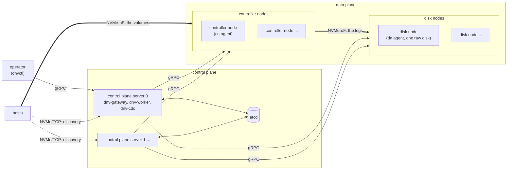
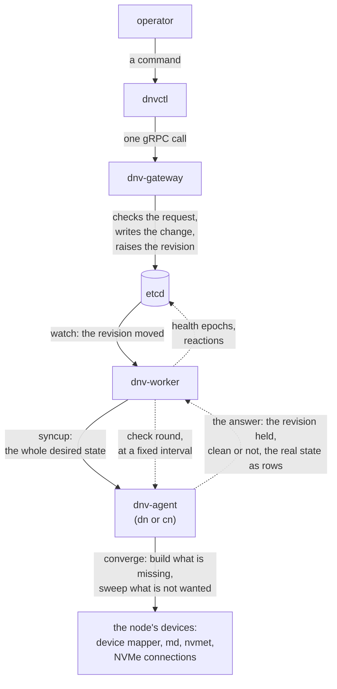
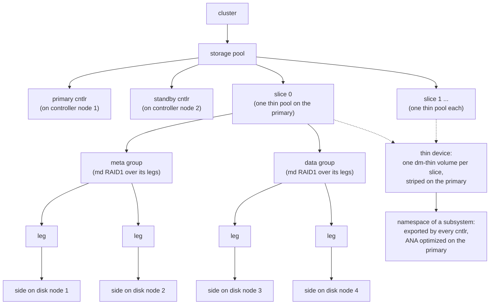
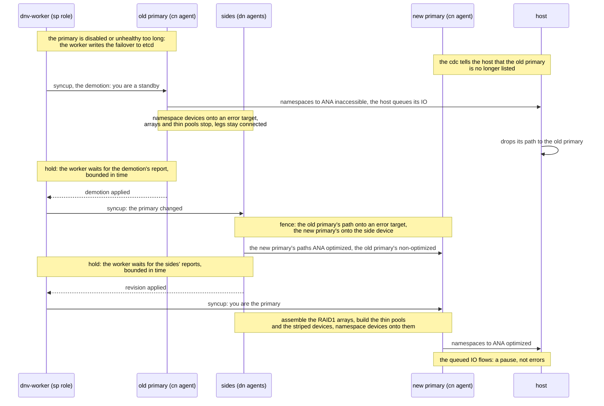
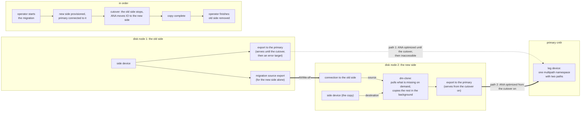
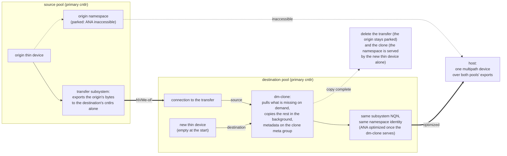

# dnv: an introduction

## What dnv is for

dnv is a distributed NVMe-oF block storage system. It aggregates the raw disks
of disk nodes into storage pools, runs the volume logic (thin provisioning,
striping, redundancy, snapshots, cloning, live migration) on controller nodes,
and exports virtual volumes to hosts over NVMe-oF with native NVMe multipath
and ANA, the NVMe way of saying which path serves IO. etcd holds all desired
state; the control-plane processes and the per-node agents converge the data
plane to it.

A host sees a volume as one namespace of an NVMe-oF subsystem. It may connect
to several controller nodes for the same volume; the kernel joins these paths
into one multipath device, and ANA picks the path. The data plane is built from stock Linux pieces: device
mapper, md RAID1 and the kernel's NVMe target and host drivers.

dnv can be the data plane of a multi-tenant block storage system, for example
behind Kubernetes or OpenStack Cinder. A tenant is a user of that system. dnv
knows no tenants and authenticates nobody: the layer above authenticates its
users and decides which storage pools, subsystems and hosts serve each of
them. dnv promises that layer that the data of one storage pool is never
readable from another storage pool, unless that layer exports it there itself,
for example with a transfer, or a step of a caller breaks it, as the limits
below say. The promise is about what a host can read, not about the network
or the nodes: the network under dnv and the root user of every node are
trusted.

The words are those of [the core glossary](core_glossary.md), the list to read
first; any other project word is explained where it first appears.

## The six programs

Three programs make the control plane, with etcd beside them. `dnv-gateway`
is the API server: it checks every request of an operator, writes any change
to etcd, and builds nothing on the nodes. `dnv-worker` makes the nodes follow
etcd, in its dn, cn and sp roles; it judges health and runs the reactions,
failover, auto-grow, cntlr replacement and leg repair, and several workers
share the work. `dnv-cdc` is the NVMe-oF discovery service: it tells a host
where its subsystems are, and when that answer changes. etcd holds the
desired state of every node and storage pool, and only those three talk to
it.

`dnv-agent` runs on every node, as the dn agent on a disk node and the cn
agent on a controller node: it builds and removes the local devices (device
mapper, md, nvmet, NVMe connections) so that the node matches its desired
state, reports the real state, keeps the last desired state it accepted in
local files, and never talks to etcd. `dnvctl` is the command line tool of
the operator, one command for each call of the gateway API.

`dnv-csi` connects dnv to Kubernetes through the Container Storage Interface
(CSI), the plugin API Kubernetes uses to create, attach and mount volumes.
Every Kubernetes volume is a storage pool of its own with one thin device, one
subsystem and one namespace. Its controller plugin talks to the gateway; its
node plugin, one per Kubernetes node, asks the cdc where the subsystem is,
connects, formats and mounts, and it follows the discovery log itself,
connecting and dropping paths as the cdc's answer changes, so that node needs
no nvme-stas, the Linux program that does this for a host.

## The physical view

Hosts talk NVMe-oF to the controller nodes, and the controller nodes talk
NVMe-oF to the disk nodes, where all volume data lives. The control plane
servers read and write etcd and reach every node through its agent over gRPC,
the remote-call protocol of the programs, which carries no IO; the operator's
`dnvctl` talks gRPC to the gateway, and hosts ask the cdc on those servers
where their subsystems are.



*The physical view: hosts, the data plane and the control plane; IO over
NVMe-oF, control over gRPC.*

## How a change travels

The gateway checks the request, writes the change to etcd and raises the
revision of the node or pool it touches. The worker sees the revision move and
sends the agent a syncup, which carries the whole desired state. The agent
converges: it reads what the node has now, builds what is missing and sweeps
what is not wanted. The check round runs the other way, at a fixed interval:
the worker asks, and the agent answers with the revision it holds, whether the
node is clean, and the real state when it changed, as rows. From the rows the
worker judges health, and a reaction is one more change in etcd, which travels
the same way down.



*How a change travels down to the devices, and the check round's answer back
up.*

## A storage pool

On the controller nodes a pool has cntlrs: exactly one is the primary, which
serves IO; the others are standby, connected to the legs and ready to take
over. On the disk nodes it has space, organized as slices, groups, legs and
sides. A slice is one thin pool on the primary; a meta group holds that thin
pool's metadata and a data group its data; a group with redundancy is an md
RAID1 array over its legs; a leg is one copy, stored as a side on one disk
node. A thin device is one dm-thin volume in every slice, joined on the
primary by one striped device, and a host sees it as a namespace of a
subsystem, which every cntlr exports under the same NQN, the name of an
NVMe-oF subsystem, ANA optimized on the primary and inaccessible on the
standbys.



*A storage pool: cntlrs, slices, groups, legs, sides, and a thin device over
the slices.*

## Failover

The worker starts a failover when the primary is disabled or has been
unhealthy for longer than the pool's threshold. The old primary is out of the
cdc's answer by then, taken out by the failover's own change or by the disable
that triggered it, so the cdc tells the hosts, and a host that follows the
discovery log drops that path and queues its IO. The worker does not wait for
that: it drives the pool's syncups in a fixed order with a hold between the
steps. First the old primary's demotion: it moves its namespaces to ANA
inaccessible before anything else, so that the host is told to stop using the
path before the path stops working, then puts its namespace devices on an
error target, a device-mapper table that fails every IO, and stops its arrays
and thin pools; its legs stay connected. Then the fence: each disk node
reloads the old primary's path onto an error target and the new primary's
onto the side device, and moves ANA with them. Then the new primary assembles
the arrays, builds the thin pools and the striped devices, and only then moves
its namespaces to ANA optimized. In the common case, a dead controller node,
the host sees a pause, not errors: its IO queues until the new primary moves
its namespaces to ANA optimized.



*A failover: demotion, fence, the new primary's build, what the host sees.*

## Migration

For the time of the migration the leg has two sides; once the new side is
provisioned both export the same subsystem, so the primary's kernel sees one
namespace with two paths and nothing above the leg changes. The operator starts the migration; the new side
is provisioned on the other disk node, and the primary connects to it. The
worker starts the cutover only once the primary has a live path to the new
side: the old side stops serving, and ANA moves the IO to the new side's
dm-clone, the device-mapper target that copies a source device into a
destination device while serving IO. The dm-clone pulls what is missing from
the old side on demand and copies the rest in the background; its metadata
lives on the disk node's disk, so a reboot resumes the copy. A caller may hand
the migration the leg's bitmap, the list of the blocks the pool has written on
the leg, so that the copy skips the rest; the limits below say when to read
it. When the copy is complete the operator finishes the migration, and the old
side is removed.



*A migration: one leg with two sides, the copy, the cutover and the finish.*

## Transfer and clone

The host on the right has one multipath device over the exports of two pools,
because the destination pool exports the same subsystem NQN and the same
namespace identity as the source. The origin is the volume being moved. A
transfer in the source pool exports the origin's bytes over a subsystem made
for this purpose, to the destination's cntlrs alone; created with the option
a live migration uses, it also parks the origin namespace, that is, moves it
to ANA inaccessible on every cntlr. A clone in the destination pool pulls those bytes
with dm-clone into a new, empty thin device, keeps the copy's metadata on the
clone meta group, a group of the pool made for this, and moves its namespace
to ANA optimized once the dm-clone serves; until that move the host's IO
queues. When the copy is complete, the operator deletes the transfer, which
keeps the origin parked, and the clone; the new thin device then serves the
namespace alone. An abort is lossless only while nothing has written through
the destination. The two pools can be in different clusters.



*A transfer and a clone: the source exports, the destination pulls, the host
moves over.*

## Requirements

dnv is tested on Ubuntu 26.04 LTS with the kernel 7.0.0-38-generic, the lab
VMs' distribution and kernel.

Tools: nvme-cli, mdadm, nvme-stas, a 2.x version with its daemons stafd and
stacd, and dmsetup, which the all-in-one tutorial installs, and losetup from
util-linux for its loop-device disks. The agents also run blkdiscard and lsblk
from util-linux and thin_dump from thin-provisioning-tools.

Kernel: the NVMe/TCP target and host drivers nvmet, nvmet-tcp, nvme-tcp and
nvme-fabrics; native NVMe multipath switched on, which joins a host's paths
into one device and carries the ANA state; md RAID1; device mapper with the
thin-pool, thin, clone, linear, striped, error and flakey targets; and configfs
mounted.

Two settings the tutorial shows: a udev rule that keeps the system's own md
assembly off dnv arrays, on disk nodes too, since a controller node's md
superblocks reach their devices through the side exports; and the masked
nvmf-connect unit, so that nvme-stas is the only program that connects to
what a discovery change announces.

etcd: a release of 3.5.13 or later, run with the request caps and automatic
compaction the tutorial's etcd command shows; the tutorial and the suites use
v3.6.14.

A host: an NVMe/TCP initiator with native multipath and a follower of the
discovery log such as nvme-stas, which drops a failed-over primary's path; a
path that no follower manages is never dropped.

To build: Go 1.26.5 or newer. For the CSI driver: a Kubernetes, k3s in its
tutorial, and docker to build the driver's image.

## Status and limits of 0.1

0.1 is the first release of dnv. Every part is exercised by the integration
suites on lab VMs and by the two tutorials. No production deployment is known.
Linux x64 is the only platform.

The network and the root user of every node are trusted: dnv authenticates no
user and no host beyond its NQN, a name a host can spoof, gRPC is plain text,
nothing is encrypted, and root on a node can read the old bytes of a recycled
extent from the raw disk. Deploy dnv on an isolated network you trust.

The limits a user must know:

- One primary per pool bounds a volume's throughput to one controller node:
  every thin device of a pool is served by its one primary, and slices split
  the work inside that node, never across nodes; to scale out, spread the
  pools across controller nodes.
- No QoS is enforced: nothing in dnv limits the IO rate of a volume or a pool.
- A snapshot is not atomic across a crash of the primary: it is taken slice by
  slice, and a crash between two slices, or a slice whose step was skipped or
  failed, leaves a torn snapshot. The torn mark is held in memory until the
  snapshot is recorded as created, so a restart, a failover or a cntlr
  replacement in between can lose it; delete and re-create a torn snapshot.
- A pool can run out of space: auto-grow is best effort, since a grow can find
  no disk node with room, a slice holds only so many data groups, and nothing
  reserves space ahead. In a full pool an
  IO that needs a new block queues for a kernel timeout and then fails; blocks
  already written keep serving.
- Corrupt thin pool metadata has no repair path in dnv: repairing it is an
  operator's job, by hand, onto fresh space.
- A leg bitmap read too early during a migration can hand a pool another
  pool's bytes. The optional fast path skips the blocks of a leg that the thin
  pool has not written; read while the old side still takes writes, it misses
  the blocks written after the read, and the pool later reads there what the
  new side's recycled extents hold. Read it only after the cutover, once the
  primary's path to the new side is ANA optimized.
- The forced start, an operator's start of a RAID1 group's array from one leg
  they name when md will not start it on its own, has sharp edges: it can
  lose the data that only the other legs held; it restores one group, not the
  pool, so a start from an older copy gives the pool a mix of older and newer
  blocks with no error; a leg of the old history taken back later can be
  copied over with no error; and while the group has a repair under way it
  can leave the group down.

## Get dnv

The release is the archive `dnv-v0.1.0-linux-amd64.tar.gz` and the file
`SHA256SUMS` on the GitHub release of the tag v0.1.0:
https://github.com/distributed-nvme/distributed-nvme/releases/tag/v0.1.0.
Download both into one directory, then check and unpack:

```
sha256sum -c SHA256SUMS
tar xzf dnv-v0.1.0-linux-amd64.tar.gz
```

The archive unpacks to one folder, `dnv-v0.1.0-linux-amd64`, with the six
binaries, the `LICENSE` file and the `deploy/` directory, the CSI driver's
image recipe and manifests.

Or clone the repository and build it with Go 1.26.5 or newer, which puts the
six binaries in `bin/`:

```
git clone https://github.com/distributed-nvme/distributed-nvme.git
cd distributed-nvme
make build
```

The version is stamped into every binary and `go version -m <binary>` prints
it, v0.1.0 for a release build; no program has a version flag.

etcd is not in the archive. Fetch etcd v3.6.14 for linux-amd64 from
https://github.com/etcd-io/etcd/releases/tag/v3.6.14, the file
`etcd-v3.6.14-linux-amd64.tar.gz`, and put its `etcd` binary beside the dnv
binaries, where the tutorial expects it.

Then read [dnv on one machine](tutorial_all_in_one.md), a whole dnv system on
one Linux machine with a host connected to a volume, and [dnv under Kubernetes
on one machine](tutorial_csi.md), which adds a one-node Kubernetes and gives a
pod, a running Kubernetes container, a dnv volume through the CSI driver. dnv
is released under the MIT license: [LICENSE](../../LICENSE).
